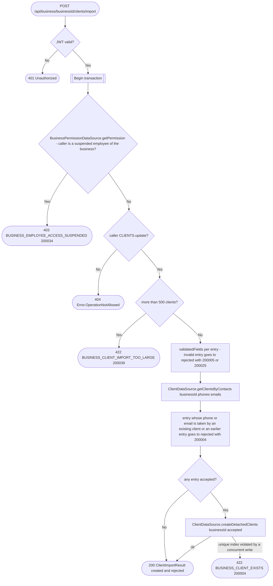

# Import clients

`POST /api/business/{businessId}/clients/import` → `ImportClients`

Batch version of [Create client](create-client.md) for importing contacts,
e.g. from the phone book: up to `ImportClients.MAX_CLIENTS` (500) detached
clients per request, so a larger phone book is sent in several requests.
The body carries no `userId`, so an import can never create an integrated
client. Every entry goes through the same field validation as a single
create (`Client.validatedFields()`); instead of failing the request, an
invalid entry is skipped and reported in `rejected` with its position in
the request and the error code a single create would have returned. Valid
entries are created in one batch insert, all in one transaction.

A phone or email is unique per business across every client, detached or
integrated (`client_business_id_phone_unique`,
`client_business_id_email_unique`), so an entry whose phone or email
already belongs to a client of the business, or to an earlier entry of
the same import, is rejected with `BUSINESS_CLIENT_EXISTS`. Emails are
compared ignoring case, like the index's collation. Existing clients are
read with one `getClientsByContacts` query for every phone and email of
the import. A concurrent write that takes one of those values between that
read and the insert fails the insert on the unique index, which rolls the
whole import back as `BUSINESS_CLIENT_EXISTS`; retrying it reports that
entry as rejected.

