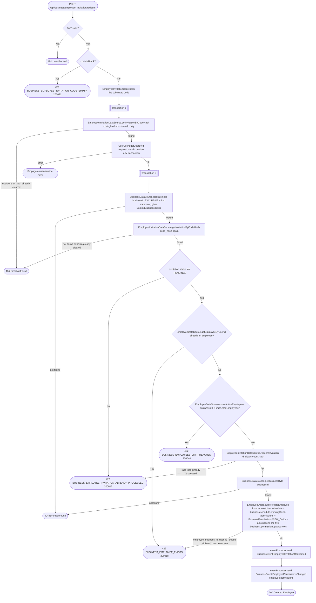

# Join business

`POST /api/business/employee_invitation/redeem` → `JoinBusiness`

Any authenticated user can join a business by submitting the invite code
shared with them by the business owner — there is no per-user targeting,
whoever holds a `PENDING` code can join. Joining creates the `Employee`
row for the calling user and grants baseline view-only access
(`view = true`, nothing else) on every `BusinessResource` — customizable
afterward by an owner via [Set employee
permissions](set-employee-permissions.md). The new employee starts on the
business's working days and hours (`Schedule.workingWeek()`, without the
business day offs), so they can be booked right away; they change it later
through [Update employee](update-employee.md). The schedule is copied in a
second transaction that first takes an exclusive lock on the business row
(`lockBusiness … EXCLUSIVE`), found through the invitation read in a first
short transaction: a concurrent [Update business](update-business.md) holds
the row until it commits, so the copy is either the schedule before that
update (the join committed first) or after it, never an old snapshot that
outlives the update. The lock is exclusive so two joins at one business run
one at a time against its limit of active employees (`max_employees`, 100
unless an operator stored another value; suspended employees don't count).
The limit is checked before the invitation is redeemed, so a refused join
leaves the code usable. Joining has no per-person limit: `max_businesses`
counts only the businesses a person owns. The joiner's profile
is fetched from the user service before the second transaction, so no
cross-service call runs while the business row is locked. `JoinBusinessImpl` (not the
datasource — see below) hashes the
submitted plaintext code (SHA-256, `EmployeeInvitationCode.hash`) and
looks it up via `EmployeeInvitationDataSource.getInvitationByCodeHash` —
the datasource only ever sees the hash, never the plaintext, see [Invite
employee](create-employee-invitation.md). `redeemInvitation` also clears
the invitation's `code_hash` column so it can be handed out again to a
future invitee. Because the hash is gone as soon as it's consumed,
resubmitting an already-redeemed code later looks identical to submitting
a code that never existed — `getInvitationByCodeHash` simply won't find
it, so the caller gets 404 rather than the 422 `ALREADY_PROCESSED` error.
That error is still reached for the genuine race: two requests fetching
the same still-`PENDING` invitation before either commits, where the
loser's `redeemInvitation` call matches zero rows. An empty or
whitespace-only code is rejected up front with 422
`BUSINESS_EMPLOYEE_INVITATION_CODE_EMPTY`, before any transaction or
database lookup is started.

The `getEmployeeByUserId` check is not a lock: one user redeeming two
different pending codes of the same business at once passes it in both
requests. The `employee_business_id_user_id_unique` index on
`(business_id, user_id)` stops the second insert, and
`.onConstraintFailure { }` turns it into the same 422
`BUSINESS_EMPLOYEE_EXISTS` the check returns. The losing transaction rolls
back, its invitation stays `PENDING`, and no events are sent.

**Consumed by:** `BusinessEvent.EmployeeInvitationRedeemed` → [notifications:
notify the inviter](../notifications/on-employee-invitation-redeemed.md).
`BusinessEvent.EmployeePermissionsChanged` → [appointments: sync employee
permissions](../appointments/on-employee-permissions-changed.md).
