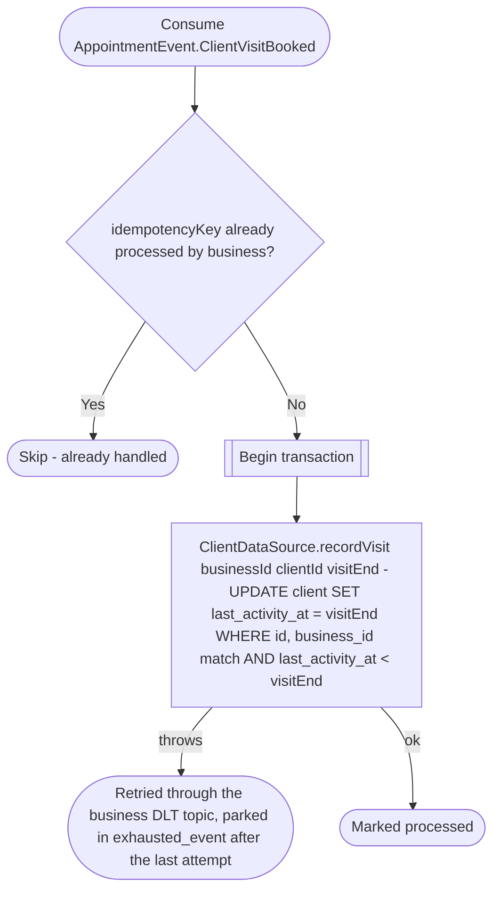

# React to a booked client visit

Kafka topic `AppointmentEvent.ClientVisitBooked` → `BusinessEventHandlerImpl` → `RecordClientVisit`

Produced by [Create appointment request](../appointments/create-appointment-request.md),
[Create appointment from a pending request](../appointments/create-appointment-from-request.md)
(automatic approval included), [Create instant appointment](../appointments/create-appointment-instant.md)
and [Update appointment (reschedule)](../appointments/update-appointment.md),
each inside the transaction that books or moves the visit.

Keeps `client.last_activity_at` at the end of the client's latest booked
visit, so the [`business-deleteInactiveClients`](../scheduled-jobs.md) job
never deletes a client with a visit inside the business's retention period
(`business.client_data_retention_months`), and never one with an upcoming
appointment. The update only moves the time forward, so redeliveries and
events arriving out of order are harmless, and it is scoped to the
business, so a client id from another business changes nothing. A client
already deleted matches no row and the event is a no-op.

