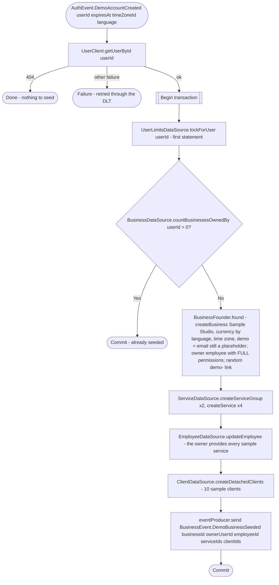

# React to a new demo account

`AuthEvent.DemoAccountCreated` → `SeedDemoBusiness`

Produced by [Start a demo account](../authorization/demo-start.md). Business
creates the sample business the demo shows: owned by the demo user, with the
owner as its only employee, the business's default working week (Monday to
Friday, 9 to 17), two service groups with two services each, and ten detached
sample clients with fictional names and `@example.com` emails. The content is
English (`DemoBusinessSample`); prices are in the currency of the device
language (EUR, PLN or UAH). The time zone is the one the device sent, UTC when
it is unknown. Like any business a demo account creates
([Create business](create-business.md)), it is marked `demo` and gets a random
`demo-` link. Sample employees other than the owner are left out, since an
employee needs a real account.

The handler may run more than once, so it locks the owner's `user_limits` row
first and seeds nothing when they already own a business: a redelivery, or a
demo user who created a business before the event arrived, changes nothing.
A demo user deleted in the meantime (the user service answers 404) is skipped.
The events of a demo arrive in no fixed order, so a user who [upgraded](../authorization/demo-upgrade.md)
before this event was handled (their profile no longer has a placeholder
email) gets the same sample business as a regular one: not marked `demo`
and without a `demo-` link, since the upgrade's flag clearing already ran.
No email, push or other outside effect happens here.

**Consumed by:** `BusinessEvent.DemoBusinessSeeded` → [appointments: seed the
sample bookings](../appointments/on-demo-business-seeded.md).
