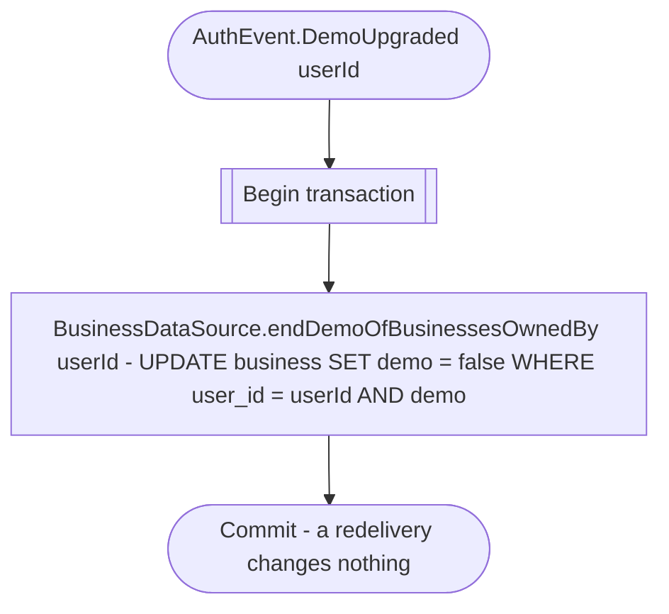

# React to a demo upgrade

`AuthEvent.DemoUpgraded` → `EndBusinessDemo`

Produced by [Upgrade a demo account](../authorization/demo-upgrade.md). The
upgraded account's businesses stop being demos: `business.demo` is cleared on
every business the user owns, so `Business.demo` is false and the client app
drops the Demo badge. The `demo-` link stays until the owner sets a real name,
which then replaces it at once ([Set business link](set-business-link.md)). The
demo limit of one owned business ends with the token's `demo` claim, so nothing
is stored for it.

