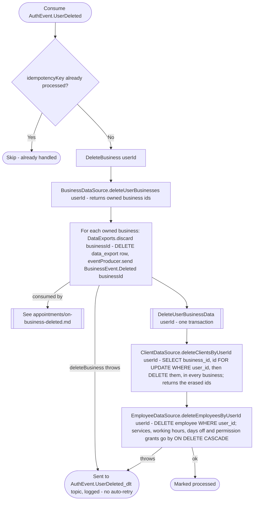

# React to user deletion

Kafka topic `AuthEvent.UserDeleted` → `BusinessEventHandlerImpl` → `DeleteBusiness` + `DeleteUserBusinessData`

Produced by [Delete account](../authorization/delete-account.md), the [`auth-handleDormantAccounts` job](../scheduled-jobs.md) and, after a backup restore, the [`auth-reapplyErasures` job](../scheduled-jobs.md). Two
steps, and only the first one gates the second: `deleteBusiness` is
unwrapped with `.getOrThrow()` inline, so if it fails the handler throws
immediately and `deleteUserBusinessData` never runs; `deleteUserBusinessData`'s
own `Result` is the lambda's return value, so *its* failure still reaches
the framework's dead-letter handling, just after the deletes below have
already been attempted.

The user's client and employee rows are deleted, not anonymized: nothing in
business needs them once the account is gone, and the appointments booked
for them keep their own erased copy of the details. Appointments handles the
same event itself and cancels the user's upcoming appointments in both
roles ([React to user deletion (appointments)](../appointments/on-user-deleted.md)).

