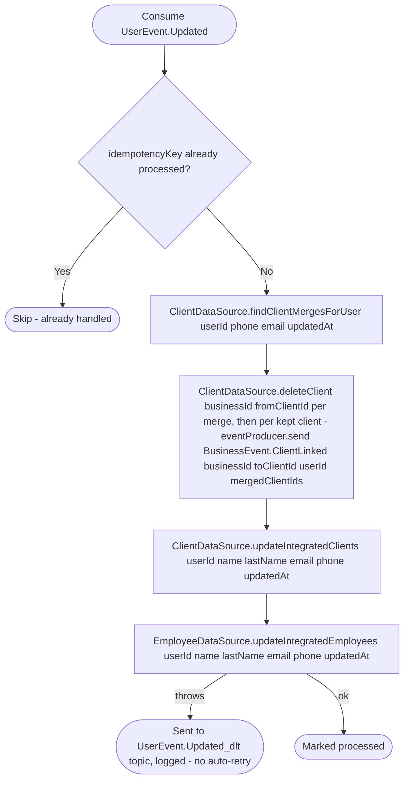

# React to user profile update

Kafka topic `UserEvent.Updated` → `BusinessEventHandlerImpl` → `SyncUserProfile`

Produced by [Update user](../user/update-user.md). Business keeps
denormalized copies of a user's name/last name/email/phone on any
`Client.Integrated` or `Employee` row linked to that `userId` (so listing
clients/employees doesn't need a live call to the user service); this
keeps those copies from going stale.

A phone or email is unique per business across every client, so a new
phone or email can collide with a detached client of a business where the
user is already integrated: the same person, entered by the business
before they used the app with other contacts. `findClientMergesForUser`
finds those rows (only through integrated rows the event is newer than,
the same `source_updated_at` guard the update uses), each one is deleted
as a duplicate, and one `BusinessEvent.ClientLinked` per kept client lists
the duplicates merged into it, so appointments moves their history onto
the user's client and records the account on it. Both happen before the
update applies the new values.
The user service keeps phones and emails unique between users, so two
integrated rows only collide while two users swap a phone and the second
update arrives first; that delivery fails on the unique index and its
retry succeeds once the first one is applied.

**Consumed by:** `BusinessEvent.ClientLinked` → [appointments: move the duplicates' history and give the client's appointments the account](../appointments/on-client-linked.md).
