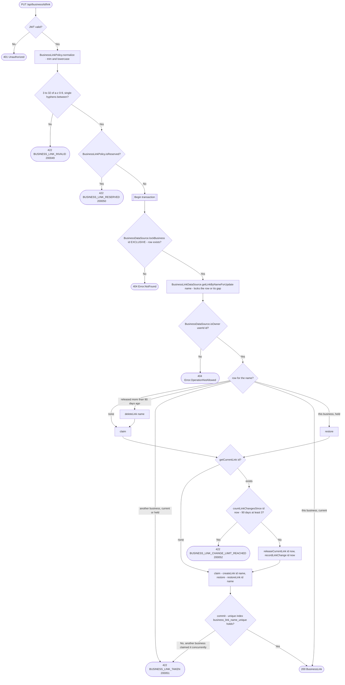

# Set business link

`PUT /api/business/{id}/link` → `SetBusinessLink`

The link is opened as `bookkme.com/{name}`; the site resolves the name with `GET /api/business/link/{name}` (`ResolveBusinessLink`, no sign-in), which also answers for a name the business replaced within the last 90 days, returning the current name; nginx limits it to 30 lookups a minute per address (`business_link_resolve`) (the site's origin may call it, like every API route, through nginx's CORS headers).

A name released more than 90 days ago counts as free here and in the lookup even before the daily `business-deleteReleasedBusinessLinks` job deletes it and the change records older than 90 days ([Scheduled jobs](../scheduled-jobs.md)). Locking the name's row stops that job from deleting a held name while the owner switches back to it. Deleting the business deletes its current and held names (`ON DELETE CASCADE`), so they are free at once.
