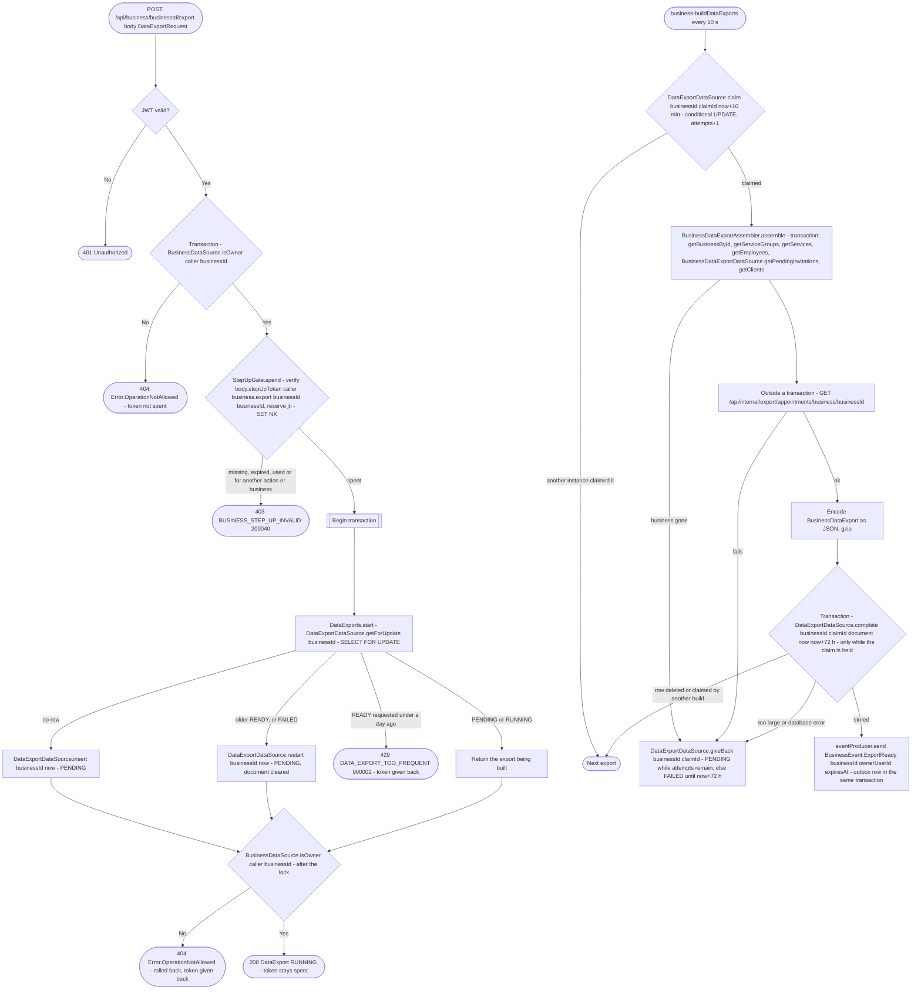

# Start business data export

`POST /api/business/{businessId}/export` → `StartBusinessDataExport`, then
the `business-buildDataExports` job → `BuildDataExports` with
`BusinessDataExportAssembler`

Queues a JSON copy of everything the business holds, for its owner only:
what the business needs to move to another system or to answer its own
clients' access requests, and what Bookk returns when it leaves (Art.
28(3)(g)). Built in the background and kept 72 hours. Lifecycle, storage
and the document's sections: [Data export](../../data-export.md).

Only the owner may export (`BusinessDataSource.isOwner`); an employee
permission is not enough, since the document holds every client at once.
Anyone else gets 404, like every permission failure. The owner check runs
twice: in its own transaction before the step-up token is spent, so a
non-owner's token is not burned and a non-owner never learns whether the
business exported today (429), and again right after the export row is
locked, so an owner who lost the business while waiting is refused.

The export must be confirmed with a passkey: the body carries a step-up
token from [Confirm a sensitive action with a
passkey](../authorization/step-up.md), issued for this caller, the action
`business.export` (`EXPORT_BUSINESS_DATA`) and this business as both
business and target. `StepUpGate.spend` checks it and spends its `jti`
once; any failure after that gives the token back.

The read routes don't mutate and have no diagram: `GET
/api/business/{businessId}/export` (the business's `DataExport`) and `GET
/api/business/{businessId}/export/download` (the JSON file
`bookk-business-data.json`, 404 while none is ready), both owner only.

The abandoned-build and claimable steps before the claim are the same as in
[Start personal data export](../user/start-personal-data-export.md).

**Consumed by:** `BusinessEvent.ExportReady` → nothing yet. The push
notification that tells the owner the export is ready is the next step of
#139 (notifications).
