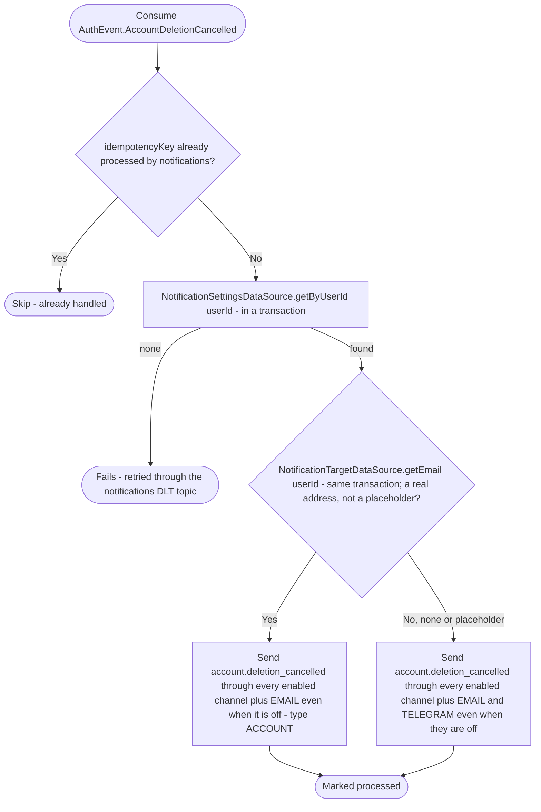

# React to a cancelled account deletion

Kafka topic `AuthEvent.AccountDeletionCancelled` → `NotificationEventHandler` → `SendNotification`

Produced by [Cancel account deletion](../authorization/cancel-account-deletion.md)
when a pending deletion is removed. Tells the user their account won't be
deleted, and that they can ask again in the app if they didn't cancel it
themselves. The notification type is `ACCOUNT`, delivered like the
[scheduled deletion notice](on-account-deletion-scheduled.md): every enabled
channel plus email, and Telegram for an account with no real address.

