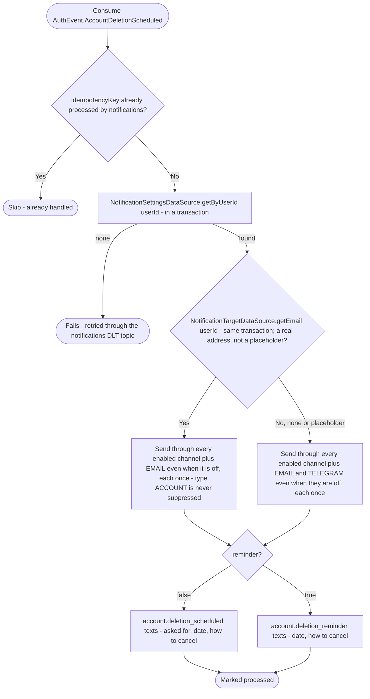

# React to a scheduled account deletion

Kafka topic `AuthEvent.AccountDeletionScheduled` → `NotificationEventHandler` → `SendNotification`

Produced by [Delete account](../authorization/delete-account.md) when the user
asks to delete their account (`reminder = false`), and by the
[`auth-handleScheduledDeletions` job](../scheduled-jobs.md) 2 days and 1 day
before the deletion (`reminder = true`, rendered as a reminder). Tells the user
when the account will be deleted (`deletesAt`, written in UTC since the user's
time zone isn't known) and that they can cancel in the app. Signing in does
not cancel it, unlike a dormancy warning.

The notification type is `ACCOUNT`, which the user can't switch off: it goes
through the channels the user has enabled and always by email, even with the
email channel off. An account with no real email address (an account created
through Telegram sign-in, until it sets a real address) gets it on Telegram as
well, even with the Telegram channel off.

