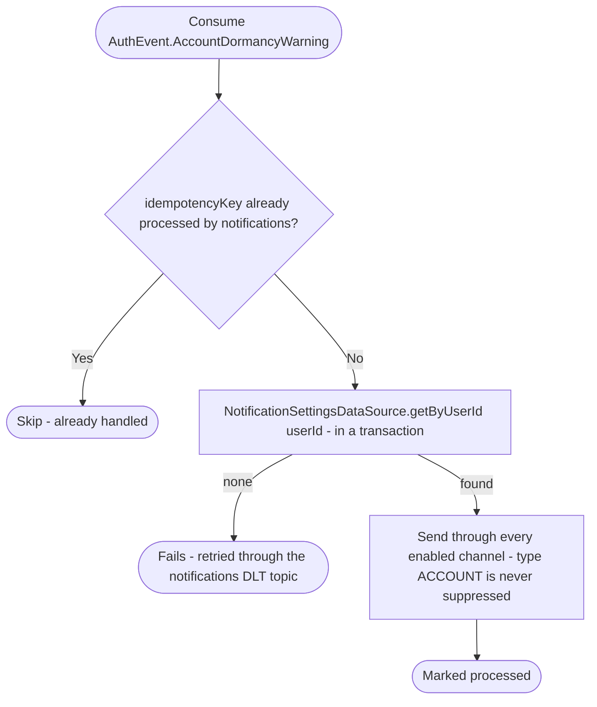

# React to a dormancy warning

Kafka topic `AuthEvent.AccountDormancyWarning` → `NotificationEventHandler` → `SendNotification`

Produced by the [`auth-handleDormantAccounts` job](../scheduled-jobs.md): 60
days before an account that hasn't been used for 3 years is deleted, again
30 days before, and a last time 7 days before (`final = true`, rendered as
the last reminder). Tells the user when the account will
be deleted (`deletesAt`, written in UTC since the user's time zone isn't
known) and that signing in keeps it.

The notification type is `ACCOUNT`, which the user can't switch off (like
employee invitations): it still goes only through the channels the user
has enabled. Push rarely arrives, because devices and their push tokens
are deleted after 30 days without sign-in. Email will carry it once email
sending exists, with no change here.

