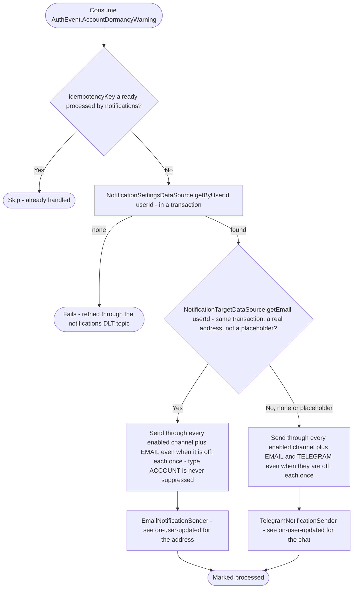

# React to a dormancy warning

Kafka topic `AuthEvent.AccountDormancyWarning` → `NotificationEventHandler` → `SendNotification`

Produced by the [`auth-handleDormantAccounts` job](../scheduled-jobs.md): 60
days before an account that hasn't been used for 3 years is deleted, again
30 days before, and a last time 7 days before (`final = true`, rendered as
the last reminder). Tells the user when the account will
be deleted (`deletesAt`, written in UTC since the user's time zone isn't
known) and that signing in keeps it.

The notification type is `ACCOUNT`, which the user can't switch off (like
employee invitations): it goes through the channels the user has enabled
and always by email, even with the email channel off. An account with no real
email address (an account created through Telegram sign-in, until it sets a real
address) gets it on Telegram as well, even with the Telegram
channel off, so it is warned before deletion. Push rarely
arrives, because devices and their push tokens are deleted after 30 days
without sign-in, so email is what reaches a dormant user.

