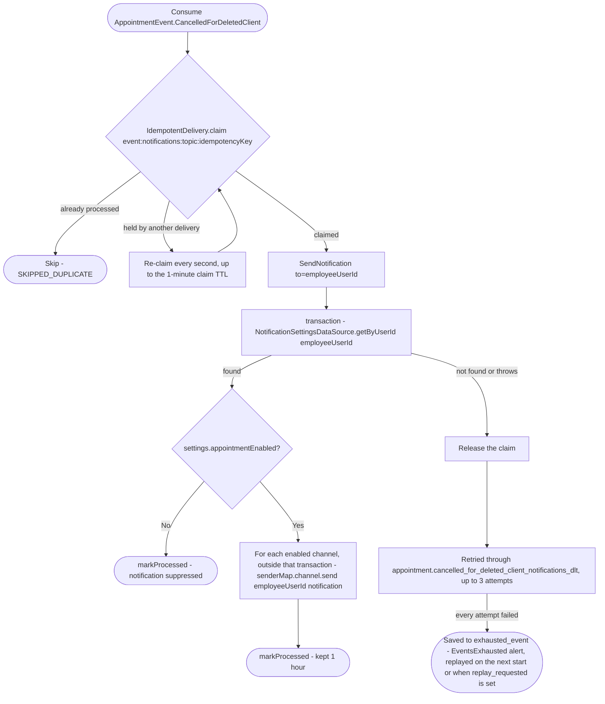

# React to an appointment cancelled by a client's deletion

Kafka topic `AppointmentEvent.CancelledForDeletedClient` → `NotificationEventHandler` → `SendNotification`

Produced once per upcoming appointment cancelled because its client deleted
their account:

- by [React to user deletion (appointments)](../appointments/on-user-deleted.md);
- by [React to a client getting an account](../appointments/on-client-linked.md),
  which runs that erasure when the account turns out to be deleted already.

Tells the employee assigned to the appointment that it was cancelled and the
time is free again (`appointment.cancelled_for_deleted_client.*`, in every
channel). A client the business removes itself is not announced to the
business ([React to client deletion](../appointments/on-client-deleted.md)
tells only the client). The event carries no client name: the client's
details are already erased when it is sent.

