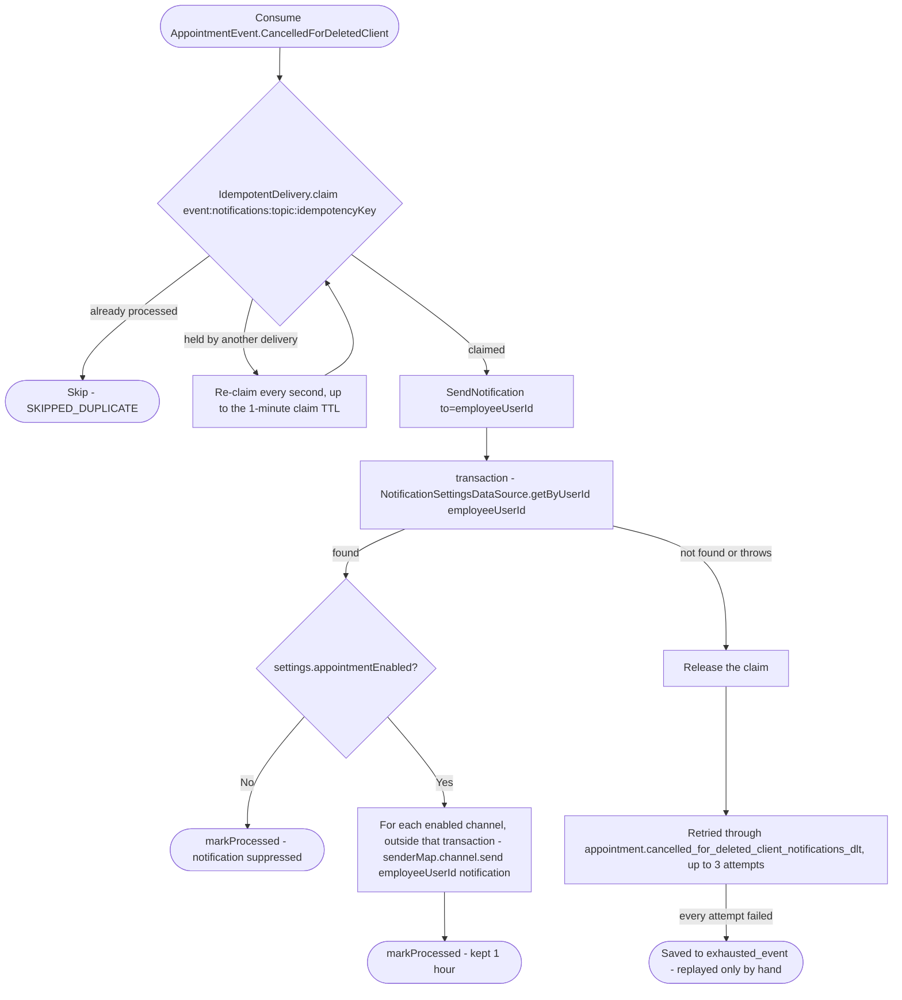

# React to an appointment cancelled by a client's account deletion

Kafka topic `AppointmentEvent.CancelledForDeletedClient` → `NotificationEventHandler` → `SendNotification`

Produced by [React to user deletion (appointments)](../appointments/on-user-deleted.md),
once per upcoming appointment it cancelled because the client deleted their
account. The same erasure also runs from [React to a client getting an
account](../appointments/on-client-linked.md) when the account turns out to
be deleted already. Tells the employee assigned to the appointment that it
was cancelled and the time is free again. The event carries no client
name: the client's details are already erased when it is sent.

