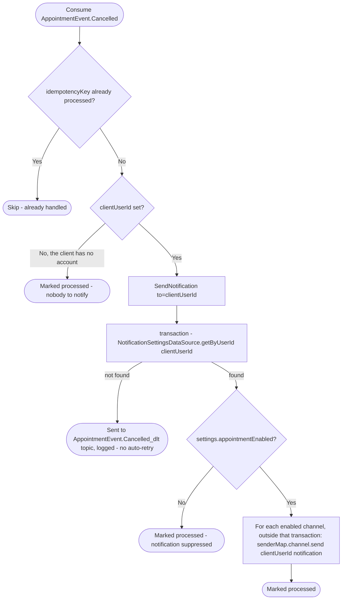

# React to appointment cancellation

Kafka topic `AppointmentEvent.Cancelled` → `NotificationEventHandler` → `SendNotification`

Produced by [Cancel appointment](../appointments/cancel-appointment.md) with the reason the staff typed (`reasonKind = STATED`), by [React to client deletion](../appointments/on-client-deleted.md) for a client with an account (`reasonKind = CLIENT_REMOVED`), and by [React to user deletion](../appointments/on-user-deleted.md) for a client with an account whose employee deleted theirs (`reasonKind = EMPLOYEE_DELETED`).
Notifies the client their appointment was cancelled. A stated reason is shown as typed, or as `appointment.reason.missing` when blank; the other kinds show the translated `appointment.reason.client_removed` or `appointment.reason.employee_deleted` instead of the stored English reason.

