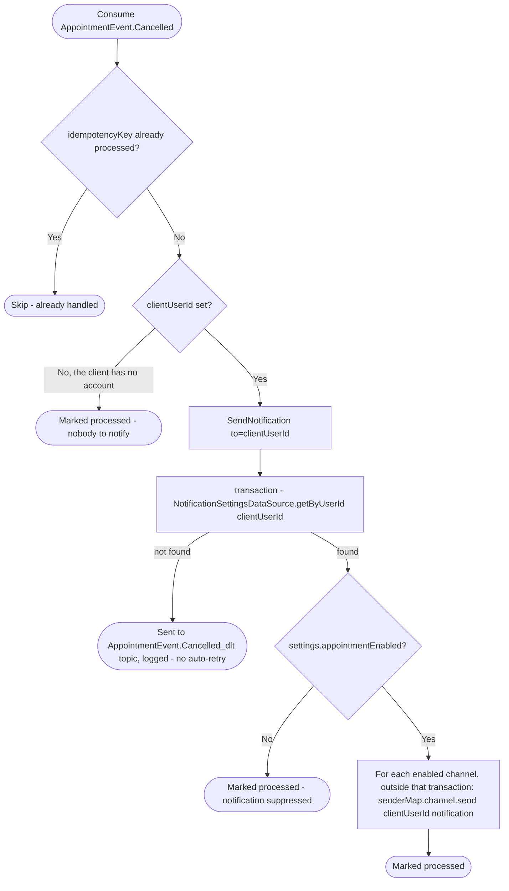

# React to appointment cancellation

Kafka topic `AppointmentEvent.Cancelled` → `NotificationEventHandler` → `SendNotification`

Produced by [Cancel appointment](../appointments/cancel-appointment.md), and by [React to client deletion](../appointments/on-client-deleted.md) for a client with an account, with the reason "Client was removed by the business", and by [React to user deletion](../appointments/on-user-deleted.md) for a client with an account whose employee deleted theirs, with the reason "Employee deleted their account".
Notifies the client their appointment was cancelled.

