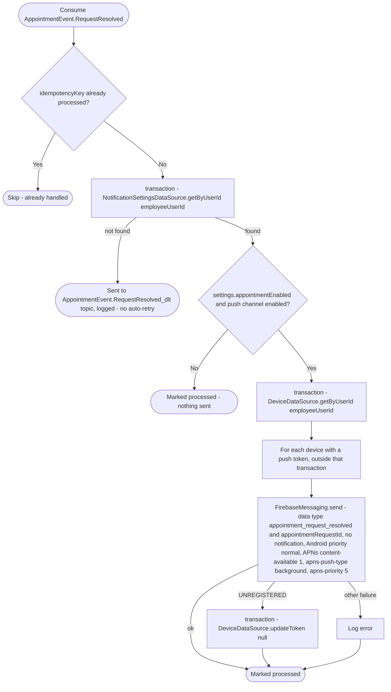

# React to a resolved appointment request

Kafka topic `AppointmentEvent.RequestResolved` → `NotificationEventHandler` → `SendNotification.data`

Produced whenever a pending request stops being pending: [approved](../appointments/create-appointment-from-request.md),
[declined](../appointments/decline-appointment-request.md),
[withdrawn](../appointments/withdraw-appointment-request.md), cancelled as
outdated by the [`appointments-deleteOutdatedRequests` job](../scheduled-jobs.md),
or deleted with its [client](../appointments/on-client-deleted.md) or the
[client's account](../appointments/on-user-deleted.md). The event carries only
the request id and the assigned employee's user id.

It sends a data-only push to every device of the employee that has a push
token, so the app can remove the request's "new appointment request" push
wherever it is still shown ([Push notifications](../../push-notifications.md)).
It follows the settings that decided whether the request push was shown: it
is sent only when the employee has appointment notifications and the push
channel on. It never goes by email or Telegram.

