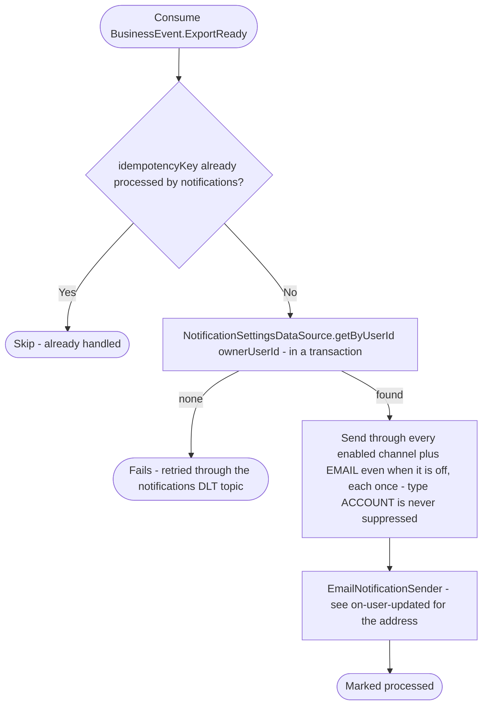

# React to a ready business data export

Kafka topic `BusinessEvent.ExportReady` → `NotificationEventHandler` → `SendNotification`

Produced by the `business-buildDataExports` job of [Start business data
export](../business/start-business-data-export.md), in the transaction that
stores the document. Tells the business's owner (`ownerUserId`, read when
the document was stored) that the business's data is ready to download in
the app and until when (`expiresAt`, in UTC).

The notification type is `ACCOUNT`, which the owner can't switch off: it
goes through the channels they have enabled and always by email, even
with the email channel off. The status route
(`GET /api/business/{businessId}/export`) reports the same.

