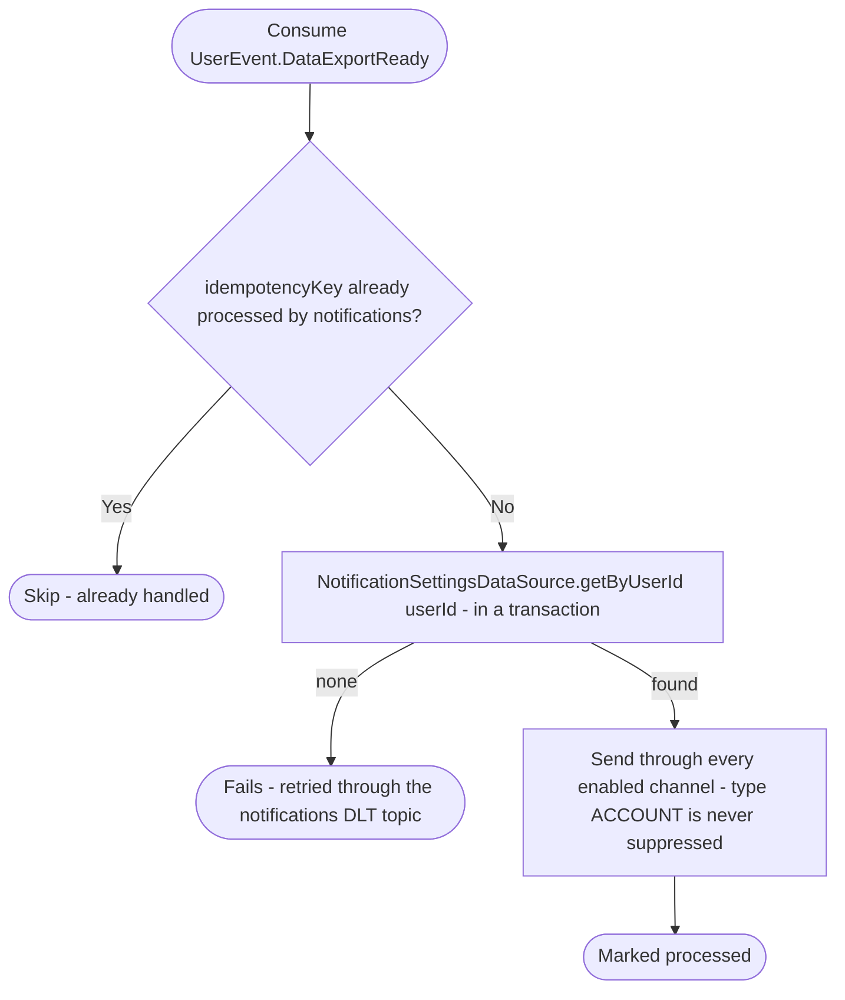

# React to a ready personal data export

Kafka topic `UserEvent.DataExportReady` → `NotificationEventHandler` → `SendNotification`

Produced by the `user-buildDataExports` job of [Start personal data
export](../user/start-personal-data-export.md), in the transaction that
stores the document. Tells the user their data is ready to download in the
app and until when (`expiresAt`, written in UTC since the user's time zone
isn't known).

The notification type is `ACCOUNT`, which the user can't switch off: it
still goes only through the channels the user has enabled. The app's
status route (`GET /api/user/export`) reports the same, for a user who
doesn't get the push.

