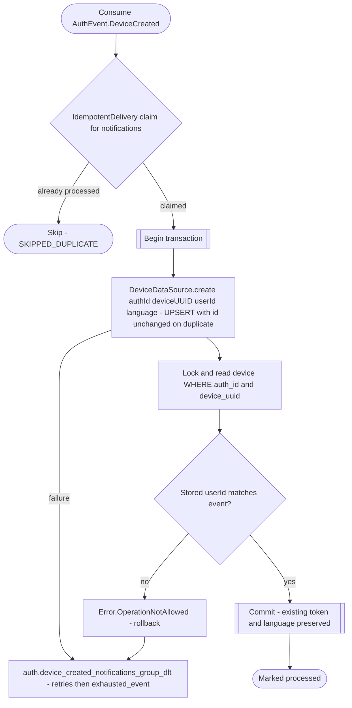

# React to device creation

`auth.device_created` → `NotificationEventHandler` → `CreateDeviceEntry`

Produced by [Verify sign-up](../authorization/sign-up.md) and [Verify sign-in](../authorization/sign-in.md). Notifications mirrors each `(authId, deviceUuid)` association independently, matching authorization. A replay preserves the row id, current token and language. A conflicting `userId` is rejected instead of changing ownership. Account deletion and later creation have no ordering guarantee; reconcile stale parked creation events against authorization before requesting replay.

