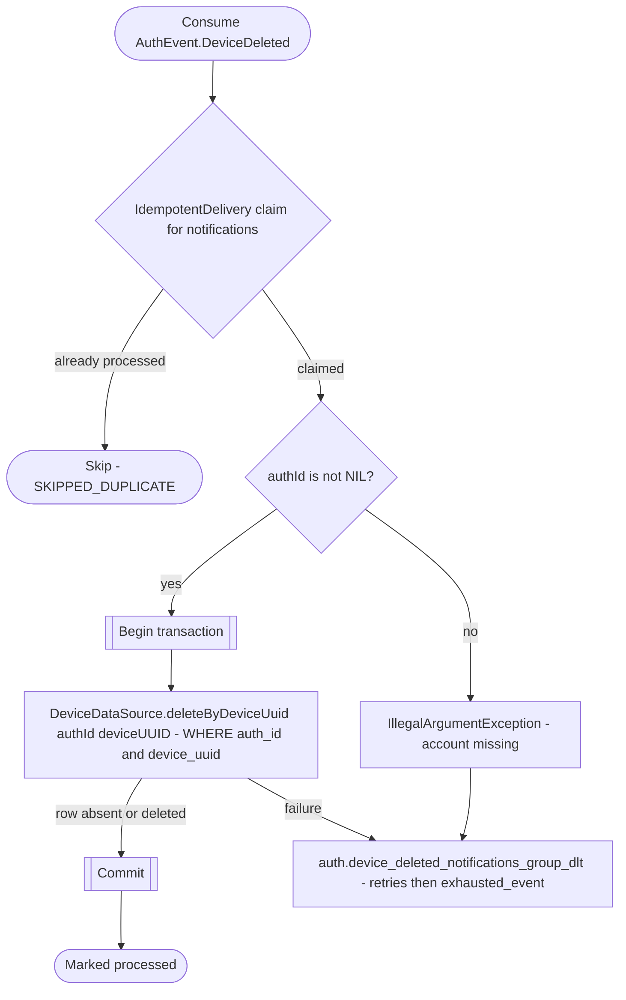

# React to device deletion

`auth.device_deleted` → `NotificationEventHandler` → `DeleteDeviceByUUID`

Produced by [Delete account](../authorization/delete-account.md), and the [inactive-device, dormant-account and erasure-replay jobs](../scheduled-jobs.md). Deletes only the named account's device association. An absent row is already deleted and succeeds. A legacy event with no `authId` is retried and parked for manual reconciliation; it never deletes every account sharing a UUID.

