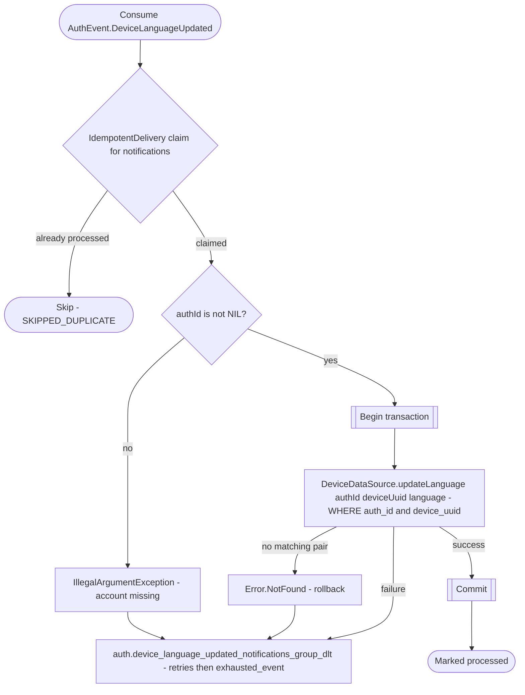

# React to device language change

`auth.device_language_updated` → `NotificationEventHandler` → `UpdateDeviceLanguage`

Produced by [Verify sign-in](../authorization/sign-in.md) when an existing account/device pair signs in again. Updates only that account's language for the installation. A legacy event with no `authId` is retried and parked for manual reconciliation.

