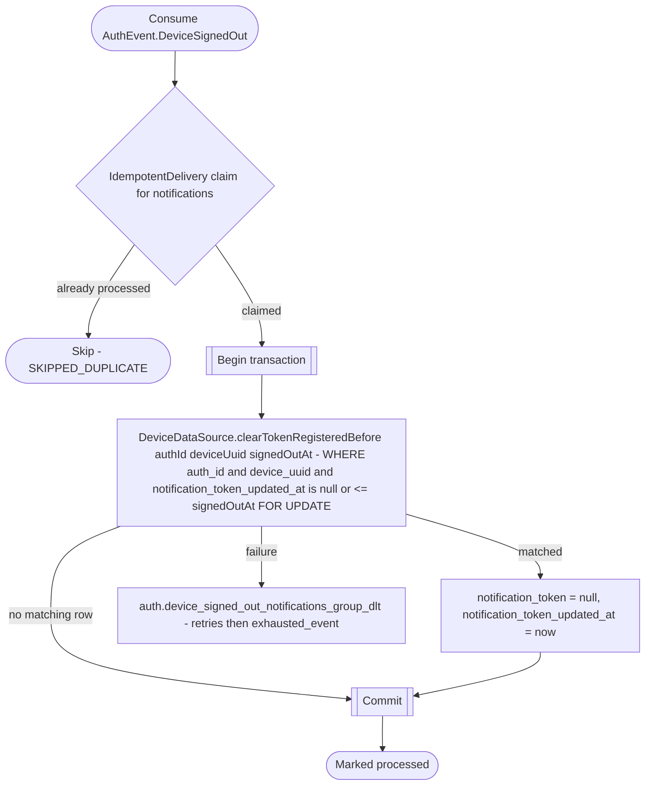

# React to device sign-out

`auth.device_signed_out` → `NotificationEventHandler` → `ClearPushNotificationToken`

Produced by [Sign out](../authorization/sign-out.md) and by a reused refresh token in [Refresh access token](../authorization/refresh-token.md). Clears the push token of the named account's device, so a signed-out phone no longer shows that account's notifications. A token registered after `signedOutAt` (the user signed in again and the app sent its token before this event arrived, or the event was retried late) is kept. An absent device has nothing to clear and succeeds.

