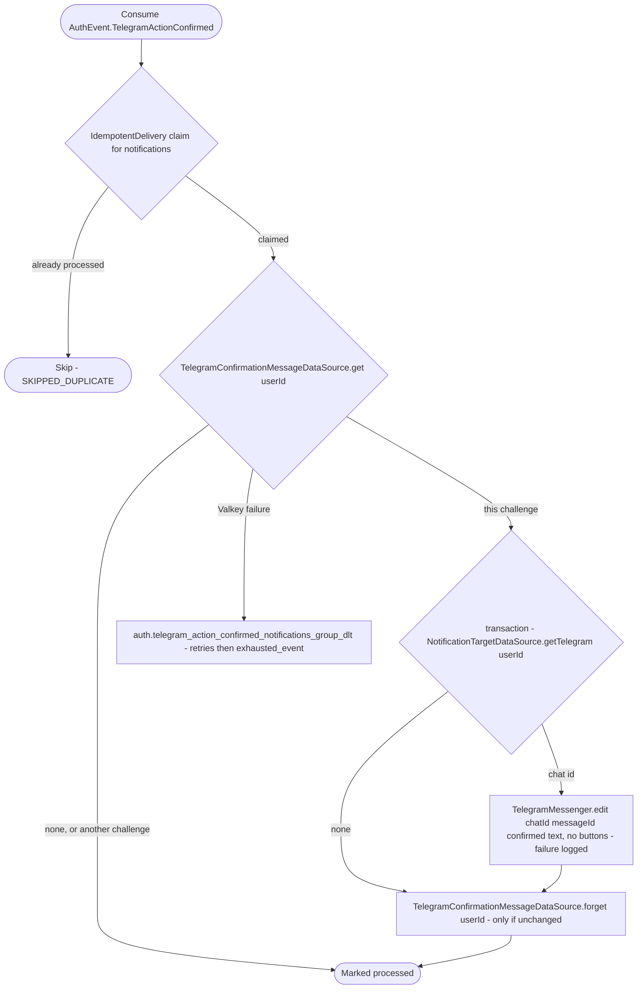

# React to a Telegram action confirmation

`auth.telegram_action_confirmed` → `NotificationEventHandler` → `TelegramConfirmationChat.markConfirmed`

Produced by [Confirm an action through Telegram](../authorization/telegram-confirm-action.md)
once the token is issued, before the app spends it on the deletion or export.
Replaces the text of the bot's confirmation message with the "confirmed" text
remembered when it was [sent](send-telegram-action-confirmation.md), which only
says the confirmation was used and the request continues in the mini app, never
that the action happened, and removes its button (`editMessageText` with an empty inline keyboard), so the
used button can't be tapped again. Only the message of the confirmed challenge
is edited: a newer confirmation message of the same user is left alone. Telegram
refusing the edit (the user deleted the message or blocked the bot), or the Bot
API failing after its client's retries, is only logged, and the message is
forgotten either way. Only a failure to read the remembered message from Valkey
fails the delivery and goes to the DLT retry.

