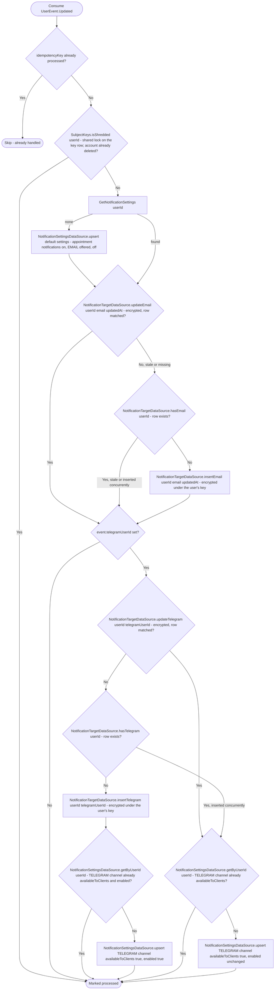

# React to user profile update

Kafka topic `UserEvent.Updated` → `NotificationEventHandler` → `UpdateTargetInformation`

Produced by [Create user (internal)](../user/create-user-internal.md) at
sign-up, [Update user](../user/update-user.md), [Store a verified
email](../user/change-user-email-internal.md) and [Replace a demo
profile](../user/upgrade-demo-profile-internal.md). Keeps the user's email
delivery target in sync with their profile email and, when the event
carries a `telegramUserId` (an account created through Telegram sign-in),
saves it as the user's Telegram target, creating default notification
settings first when the user has none, and offers the Telegram channel to
the app (`availableToClients = true`). The event that saves the account's
first Telegram target also turns the channel on; a later event leaves
`enabled` as it is, so a channel the user or the server turned off stays
off. Both targets are written in one
transaction. The Telegram user id never changes, so its target has no
`updatedAt` ordering: an existing row is overwritten with the same id. An update that arrives
after the account was deleted (`SubjectKeys.isShredded`) creates neither
settings nor a target and is still marked processed. That check is the
transaction's first statement and holds a shared lock on the user's key
row (or the gap where it would be), so an
[account deletion](on-user-deleted.md) running at the same time either
waits for this update and then deletes what it wrote, or finishes first
and this update sees the tombstone. The address is stored
encrypted under the user's key (`TargetCipher`). Every profile email
is verified before it is stored, so this table only ever holds verified
addresses, and `EmailNotificationSender` mails nothing else: it reads the
address and the language of the device the user signed in to last
(`DeviceDataSource.getLastUsedLanguage`, English without one) in a
transaction, then sends through `EmailSender` outside it. A user with no
address gets no email, and a failed send is logged without failing the
event or the other channels. `TelegramNotificationSender` works the same
way: it reads the chat id (the Telegram user id) and the language in a
transaction, then sends the notification's plain text through the Bot API's
`sendMessage` outside it. When Telegram answers 403 (the user blocked the
bot or never allowed it to write), it turns the user's Telegram channel off
in a new transaction. Without `APPLICATION_TELEGRAM_BOT_TOKEN` nothing is
sent.

