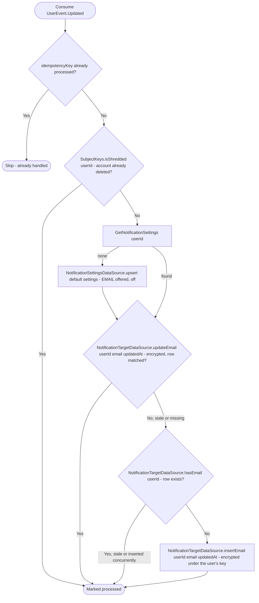

# React to user profile update

Kafka topic `UserEvent.Updated` → `NotificationEventHandler` → `UpdateTargetInformation`

Produced by [Create user (internal)](../user/create-user-internal.md) at
sign-up, [Update user](../user/update-user.md) and [Store a verified
email](../user/change-user-email-internal.md). Keeps the user's email
delivery target in sync with their profile email, creating default
notification settings first when the user has none. An update that arrives
after the account was deleted (`SubjectKeys.isShredded`) creates neither
settings nor a target and is still marked processed. The address is stored
encrypted under the user's key (`TargetCipher`). Every profile email
is verified before it is stored, so this table only ever holds verified
addresses, and `EmailNotificationSender` mails nothing else: it reads the
address and the language of the device the user signed in to last
(`DeviceDataSource.getLastUsedLanguage`, English without one) in a
transaction, then sends through `EmailSender` outside it. A user with no
address gets no email, and a failed send is logged without failing the
event or the other channels.

