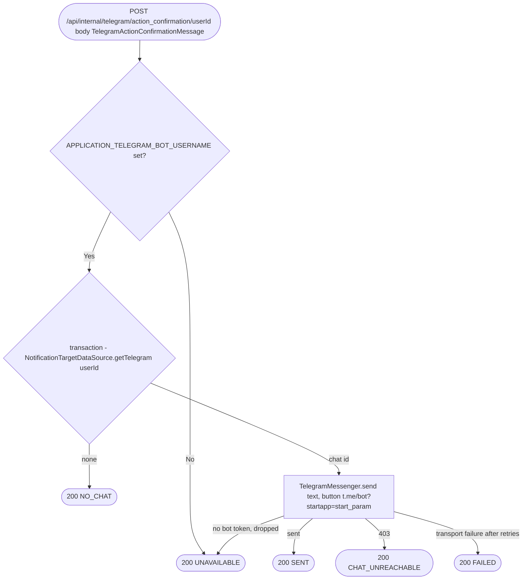

# Send a Telegram action confirmation link

`POST /api/internal/telegram/action_confirmation/{userId}` → `SendTelegramActionConfirmation` (internal, called by auth's [Start confirming an action through Telegram](../authorization/telegram-confirm-action-start.md))

The bot writes to the user's private chat, in the language auth passes (the
start request's `Accept-Language`), which action they asked to confirm, with a
URL button that opens the Mini App with the given `start_param`
([launch parameters](../../telegram-launch-parameters.md)). Plain text, no
`parse_mode`. It is sent even when the user turned the Telegram notification
channel off, and a 403 leaves that setting alone: the user can allow the bot to
write (`requestWriteAccess`) and start again. The chat id is the stored
Telegram user id (`notification_telegram_targets`). Nothing is written. A
Bot API failure, after the Bot API client's own retries, is logged and answered
as `FAILED`, never as a 500, and auth calls this route without retries, so a
slow send can't make the bot write twice.

