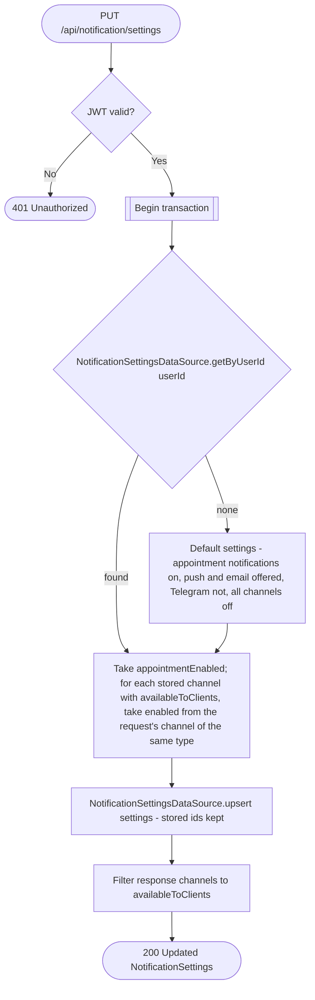

# Update notification settings

`PUT /api/notification/settings` → `UpdateNotificationSettings`

Keyed on the caller's `userId`: the first call creates the default
settings, every later call changes the stored ones. Only `appointmentEnabled`
and each channel's `enabled` are taken from the request. Channels are
matched by `channel`, so the ids in the request and the request's own
`availableToClients` are ignored; a channel left out keeps its state. A
channel that is not offered to the user (`availableToClients = false`) is
never switched on. Push and email are offered to everyone. Telegram is
offered, and turned on, once the user has a Telegram target
([React to user profile update](on-user-updated.md)); the app should call
the Mini App's `requestWriteAccess()` right after Telegram sign-in and
before turning the channel back on, because the bot can only write to a
user who allowed it, and a message it may not send turns the channel off. The response strips channels not
offered.

