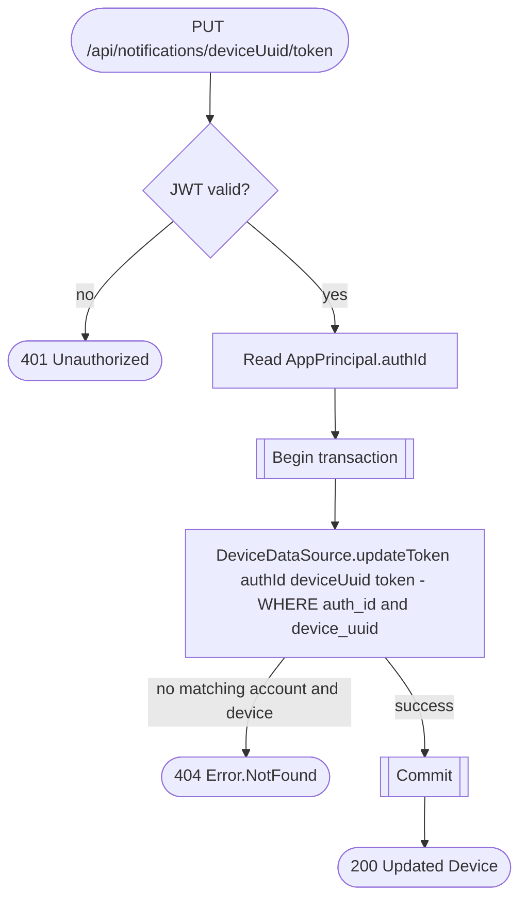

# Update push notification token

`PUT /api/notifications/{deviceUuid}/token` → `UpdatePushNotificationToken`

The route takes `authId` from `AppPrincipal` and the installation UUID from the path. The URL, request body and response remain unchanged. Only the caller's account/device association is updated; another account's association with the same installation is independent. An unknown or foreign device returns 404.

