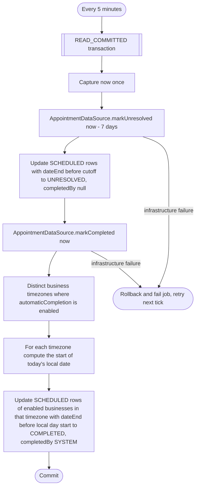

# Scheduled (recurring) jobs

Background operations that run on a fixed interval instead of being
triggered by an HTTP request or a Kafka event. Each microservice that has
recurring work exposes an `Application.register<Svc>Jobs(scheduler: SchedulerConfiguration)`
function in its `<Svc>Microservice.kt` that registers one or more
`job(name, interval) { ... }` blocks, resolving each operation from the
service's Koin scope. The standalone `main()` calls it inside
`install(Scheduler) { ... }`; `MonolithServer` installs a single
`Scheduler` whose `registerMonolithJobs` calls every service's
`register<Svc>Jobs` into the same configuration, so job
names must be unique across all services, not just within one. Every job
name therefore starts with its service's name constant and a dash
(`"$AUTH_SERVICE_NAME-rotateSigningKeys"` → `auth-rotateSigningKeys`, next to
`business-rotateSigningKeys`), which `MonolithJobsTest` enforces.

## How the scheduler works

- `Scheduler` (`library/scheduler/src/main/kotlin/library/scheduler/SchedulerPlugin.kt`) is a Ktor
  application plugin. It starts a `JobRunner` on `ApplicationStarted` and cancels it on
  `ApplicationStopping`.
- Each registered job runs on its own coroutine (`Dispatchers.Default` by default), waits
  `initialDelay` (zero unless specified), then loops: run the job's `action`, wait `interval`,
  repeat.
- A job that throws is caught and logged (`Scheduled job '<name>' failed`) by the runner; the
  loop is **not** broken — the job simply retries on its next tick after `interval`.
- Job names must be unique per `Scheduler` installation (enforced at registration).
- **No distributed lock.** If a microservice runs with more than one replica, every replica runs
  every job on its own schedule — jobs must be safe to run concurrently/redundantly (all current
  jobs are idempotent deletes/updates keyed on a time cutoff, so redundant runs are harmless).
- Operations invoked by a job still go through `transactionManager.transaction { }` like any other
  operation, so a mid-job failure rolls back cleanly; see the invoked operation's own error cases
  for what "failure" can mean (in practice: infra errors only — none of the jobs below have
  business error cases, since they take no caller input to validate).

## Appointments service

Registered in `registerAppointmentsJobs` (`AppointmentsMicroservice.kt`).

| Job | Interval | Operation | What it does |
|---|---|---|---|
| `appointments-markAppointmentsAsCompleted` | 5 minutes | `MarkAppointmentsCompleted` | Marks expired scheduled appointments `UNRESOLVED`, then automatically completes eligible appointments after their business-local end day, in one `READ_COMMITTED` transaction. See [Appointment finalization](#appointment-finalization). |
| `appointments-deleteOutdatedRequests` | 1 hour | `DeleteOutdatedRequests` | `AppointmentRequestDataSource.cancelOutdated(now)` — cancels pending appointment requests whose slot has passed (`dateEnd < now`). |
| `appointments-deleteExpiredRequests` | 1 day | `DeleteExpiredRequests` | `AppointmentRequestDataSource.deleteEndedBefore(now - 60 days)` in a `READ_COMMITTED` transaction: deletes every request whose slot ended more than 60 days ago, whatever its status (pending ones were already cancelled by `deleteOutdatedRequests`, approved ones live on as appointments). Uses the `appointment_request.date_end` index. |
| `appointments-fillBusinessOwners` | 1 hour, first run at start | `FillBusinessOwners` | Until 0.19.0 makes `owner_user_id` NOT NULL: lists the businesses without an owner (`getBusinessIdsWithoutOwner`, indexed) and asks business for each one (`BusinessClient.getBusinessById`, outside any transaction, in-process in the monolith and internal HTTP between microservices). One transaction per business reads `deleted_user` for the owner first (shared lock), then fills it (`fillMissingOwner`, only while still `NULL`) or, for an owner already deleted, selects the client ids of its appointments and requests (`getClientIdsForUpdate`), drops the business (`detachBusinesses`) and then shreds those clients' keys. A business that business no longer has (`BUSINESS_NOT_FOUND` or a bare 404) is dropped the same way. A failed lookup, or an answer without an owner from an older business service, fails the run after the other businesses are done, and the next run tries again. |
| `appointments-encryptPlaintextSnapshots` | 10 minutes | `EncryptPlaintextSnapshots` | Encrypts the `appointments.appointment` and then the `appointments.appointment_request` rows still stored as plaintext from before 0.18.0, 100 per `READ_COMMITTED` transaction (locked with `FOR UPDATE`, so the scan doesn't keep locks on rows it already encrypted): the client snapshot and note under the client's key, the employee name under the employee's user key, then sets the plaintext columns to NULL. An erased person's plaintext (shredded key, or an employee set to the nil UUID) is only dropped. Once none are left each run is one query per table; removed in 0.19.0 with the plaintext columns. |
| `appointments-deleteExpiredTombstones` | 1 day | `DeleteExpiredTombstones` | `DeletedUserDataSource.deleteMarkedBefore` and `DeletedClientDataSource.deleteMarkedBefore` with `now - 60 days`, in one `READ_COMMITTED` transaction. 60 days is twice the 30-day backup window, so a restore still finds the tombstones it needs, and longer than parked events live (30 days), so a late `ClientLinked` replayed from `exhausted_event` still finds its tombstone. |

### Appointment finalization

`automaticCompletion` controls end-of-day completion only. For each timezone
used by a business with the setting enabled, `markCompleted(now)` calculates
the start of the current local date with `atStartOfDayIn`. Scheduled appointments
whose `dateEnd` is strictly before that instant become `COMPLETED`, with
`completedBy = SYSTEM`. This handles daylight-saving changes and offsets
without relying on the database's timezone configuration. A visit crossing
midnight belongs to the day it ends; an appointment ending exactly at midnight
belongs to the new day and waits until that day has passed.

The same job first calls `markUnresolved(now - Appointment.EDIT_WINDOW)` for
all businesses. A remaining `SCHEDULED` appointment becomes `UNRESOLVED`
only once more than 7 days have passed since its end. Its `completedBy` stays
null. Expiration runs before completion, so a visit the job missed for more
than a week becomes unresolved even when automatic completion is enabled.
The exact 7-day boundary stays editable. Completed, cancelled, no-show and
already unresolved appointments keep their recorded outcomes.

Staff can correct scheduled, completed and no-show appointments within the
edit window: cancel, reschedule, adjust the price or correct the recorded outcome. Rescheduling reopens
the appointment as `SCHEDULED` and clears its previous completion attribution
and checkout adjustment when its date or employee changes. Detail-only edits
preserve the recorded outcome and checkout. Cancellation is terminal: cancelled
appointments cannot be restored, and staff must create a new booking. `UNRESOLVED` is terminal; every correction is
refused with 422 `APPOINTMENT_EDIT_WINDOW_CLOSED` (300026).

No event is published. The updates are safe to repeat and conditional on the
current status, so a concurrent staff correction is preserved.

## Authorization service

Registered in `registerAuthJobs` (`AuthMicroservice.kt`).

| Job | Interval | Operation | What it does |
|---|---|---|---|
| `auth-rotateSigningKeys` | 1 day | `RotateSigningKeys` (`retireInterval = 7.days`) | Generates a new RSA key pair and inserts it as the active signing key, marks the previously active key `RETIRING`, then deletes any key that has been retired for more than `retireInterval`. |
| `auth-deleteInactiveDevices` | 1 day | `DeleteInactiveDevices` | `DeviceDataSource.deleteInactiveDevices(olderThan = now - 30.days)`, returns each deleted `(authId, deviceUuid)` atomically through `DELETE RETURNING`, then sends `AuthEvent.DeviceDeleted(authId, deviceUuid)` for every deleted association. Other accounts on the same installation are unaffected. |
| `auth-handleDormantAccounts` | 1 day | `HandleDormantAccounts` | Deletes accounts nobody used for 3 years, with warnings first. `authentication.last_active_at` is set by every token refresh and sign-in (`GenerateAuthToken` → `AccountDataSource.recordActivity`, at most once a day, and always when a warning is pending, which resets `dormancy_stage` to `ACTIVE`); existing accounts start at the 0.17.0 migration time. The job lists accounts whose last activity is older than 36 months minus 60 days and whose `authentication.deletion_hold` is false (`getDormantAccounts`); a held account gets no warning and is never deleted, and one put on hold after it was listed is skipped because the locked row no longer matches. For each, it first asks business which other members the user's own business has (`BusinessClient.getOwnedBusinessMemberIds`, internal `GET /api/internal/owner/{userId}/members`) and skips the account while any of them was active within the 36 months, so an owner whose business is still in use is never warned or deleted. Then, in a transaction that locks the account first (`getDormantAccountForUpdate`) and skips it if it changed since it was listed: stage `ACTIVE` → sends `AuthEvent.AccountDormancyWarning(final = false, deletesAt = now + 60 days)` and stores `SENT_60_DAY_WARNING` with `dormancy_warned_at = now`; `SENT_60_DAY_WARNING` and 30 days before the deletion date (`first warning + 60 days`) → sends a second warning (`final = false`, same `deletesAt`) and stores `SENT_30_DAY_WARNING`; `SENT_30_DAY_WARNING` and 7 days before it → sends the final warning (`final = true`) and stores `SENT_7_DAY_WARNING`; each step keeps `dormancy_warned_at` at the first warning, so the deletion date never moves; `SENT_7_DAY_WARNING` and 60 days since the first warning → `AccountEraser.erase`, the same erasure as [Delete account](authorization/delete-account.md) (`authorization.erased_account` record, `AuthEvent.UserDeleted`, one `AuthEvent.DeviceDeleted(authId, deviceUuid)` per device, the account row deleted with its passkeys and devices). Warnings reach the user through [React to a dormancy warning](notifications/on-account-dormancy-warning.md). One failing account doesn't stop the others; the job reports the first failure afterwards. |
| `auth-reapplyErasures` | 1 minute, and at every start | `ReapplyAccountErasures` | Erases again the accounts a backup restore brought back. Reads the `authorization.erased_account` rows with `reapply_requested` (only the restore tool sets it, see [Restoring prod](../../deployment/ansible/README.md#restoring-prod)), then per row, in its own transaction, claims it first (`claimReapply`: an `UPDATE … SET reapply_requested = FALSE WHERE … AND reapply_requested`, which locks the row and lets only one instance through during a `start-first` deploy) and runs `AccountEraser.erase` when the account exists, or only sends `AuthEvent.UserDeleted` when it doesn't, so the other services still erase what they hold. A normal start finds nothing to do. One failing account doesn't stop the others; the job reports the first failure afterwards. |
| `auth-deleteExpiredErasureRecords` | 1 day | `DeleteExpiredErasureRecords` | Deletes `authorization.erased_account` rows older than 60 days, twice the 30 days of backups, so every restore point still finds every erasure made after it. |

**Consumed by:** `AuthEvent.DeviceDeleted` from inactive-device cleanup, dormant-account erasure and erasure replay → [notifications: remove the account/device association](notifications/on-device-deleted.md).

## Business service

Registered in `registerBusinessJobs` (`BusinessMicroservice.kt`).

| Job | Interval | Operation | What it does |
|---|---|---|---|
| `business-rotateSigningKeys` | 7 days | `RotateSigningKeys` (`retireInterval = 7.days`) | Generates a new RSA key pair and inserts it as the active signing key, marks the previously active key `RETIRING`, then deletes any key that has been retired for more than `retireInterval`. |
| `business-deleteDayOffsInThePast` | 1 day | `DeleteDayOffsInThePast` | `BusinessDataSource.deleteDayOffsInThePast()` — removes day-off ranges whose end date has already passed. |
| `business-expireEmployeeInvitations` | 1 day | `ExpireEmployeeInvitations` | `EmployeeInvitationDataSource.expireOldInvitations(now - 7.days)` — marks every still-`PENDING` invitation older than 7 days as `EXPIRED` and clears its `code_hash` column so the code can be reused. |
| `business-deleteProcessedEmployeeInvitations` | 1 day | `DeleteProcessedEmployeeInvitations` | `EmployeeInvitationDataSource.deleteProcessedInvitations(now - 30.days)` — hard-deletes every non-`PENDING` (redeemed, revoked, expired) invitation whose `updatedAt` is older than 30 days (or, for legacy rows with no `updatedAt`, whose `createdAt` is). The 30-day retention must stay longer than the 24-hour daily invitation quota window of [Invite employee](business/create-employee-invitation.md), since the quota counts these rows. |
| `business-deleteInactiveClients` | 1 day | `DeleteInactiveClients` | Reads every business's `business.client_data_retention_months` (`BusinessDataSource.getClientDataRetentionMonths`), then for each business, in its own `READ_COMMITTED` transaction (record locks only, so it doesn't hold up new clients of that business; `ClientRetentionMariaDbTest` shows REPEATABLE READ would), selects with `ClientDataSource.getInactiveClientIdsForUpdate(businessId, now - months)` the business's clients whose `last_activity_at` is older than the cutoff (`(business_id, last_activity_at)` index) and whose `deletion_hold` is false, locking them, and stops there when there are none. Otherwise it deletes them in one statement (`deleteClients`), records them in `business.erased_client` in one batch insert (`recordAll`), sends `BusinessEvent.ClientDeleted` for each, discards the business's data export (`DataExports.discard`) and shreds their keys last, which appointments erases exactly like a deletion from [Delete client](business/delete-client.md) ([React to client deletion](appointments/on-client-deleted.md)). `last_activity_at` is the client's latest booked visit end ([React to a booked client visit](business/on-client-visit-booked.md)), or when the row was created, edited or taken over by a booking; clients that existed before 0.17.0 start at the migration time. A client with an upcoming appointment is never deleted, since its activity is that appointment's end. A failing business doesn't stop the others; the job reports the first failure afterwards. |
| `business-reapplyErasures` | 1 minute, and at every start | `ReapplyClientErasures` | Deletes again the clients a backup restore brought back: per `business.erased_client` row with `reapply_requested`, in its own transaction, claims it first (`claimReapply`), deletes the client row if it exists (`ClientDataSource.deleteClient`), discards the business's data export (`DataExports.discard`, the row and its key), sends `BusinessEvent.ClientDeleted` and shreds the client's key last, the shred and the event either way (the restored key backup may predate the shred), which appointments erases like any client deletion ([React to client deletion](appointments/on-client-deleted.md)). One failing client doesn't stop the others. |
| `business-deleteExpiredErasureRecords` | 1 day | `DeleteExpiredErasureRecords` | Deletes `business.erased_client` rows older than 60 days. |
| `business-buildDataExports` | 1 minute | `BuildDataExports` (`library/export`, with `BusinessDataExportAssembler`) | Builds the queued business data exports the same way as `user-buildDataExports`, from the business's own data and appointments' part, and sends `BusinessEvent.ExportReady` in the transaction that stores the document. See [Start business data export](business/start-business-data-export.md). |
| `business-deleteExpiredDataExports` | 1 hour | `DeleteExpiredDataExports` (`library/export`) | Deletes `business.data_export` rows whose `expires_at` passed and shreds their documents' keys in the same transaction. |
| `business-encryptPlaintextContacts` | 10 minutes | `EncryptPlaintextContacts` | Encrypts the `business.client` and then the `business.employee` rows still stored as plaintext from before 0.18.0, 100 per transaction (locked with `FOR UPDATE`), clients under their own key and employees under their user's key, fills `client.email_index` and sets the plaintext columns to NULL. Once none are left each run is one query per table; removed in 0.19.0 with the plaintext columns. |

## User service

`Application.registerUserJobs` in `service/user/microservice/src/main/kotlin/com/bookk/user/microservice/UserMicroservice.kt`.

| Job | Interval | Operation | What it does |
|---|---|---|---|
| `user-buildDataExports` | 1 minute | `BuildDataExports` (`library/export`, with `PersonalDataExportAssembler`) | Builds the queued personal data exports: fails abandoned builds that used up their 3 attempts, claims each queued row with a conditional `UPDATE` and a 10-minute lease (one instance per row), gathers the user's data from every service outside a transaction, then stores the gzipped document, encrypted under a new random key (`key_id`), under the claim and sends `UserEvent.DataExportReady` in the same transaction. A failed build goes back to the queue, and is `FAILED` after the third attempt. See [Start personal data export](user/start-personal-data-export.md) and [Data export](../data-export.md). |
| `user-deleteExpiredDataExports` | 1 hour | `DeleteExpiredDataExports` (`library/export`) | Deletes `user.data_export` rows whose `expires_at` passed (72 hours after the document was built or the export failed) and shreds their documents' keys in the same transaction. |
| `user-encryptPlaintextProfiles` | 10 minutes | `EncryptPlaintextProfiles` | Encrypts the `user.profile` rows still stored as plaintext from before 0.18.0, 100 per transaction (locked with `FOR UPDATE`), under each user's key, fills `email_index`/`phone_index` and sets the plaintext columns to NULL. Once none are left each run is one query; removed in 0.19.0 with the plaintext columns. |

## Notifications service

`Application.registerNotificationsJobs` in `service/notifications/microservice/src/main/kotlin/com/bookk/notifications/microservice/NotificationsMicroservice.kt`.

| Job | Interval | Operation | What it does |
|---|---|---|---|
| `notifications-encryptPlaintextTargets` | 10 minutes | `EncryptPlaintextTargets` | Encrypts the `notification_email_targets` and then the `notification_telegram_targets` rows still stored as plaintext from before 0.18.0, 100 per transaction (locked with `FOR UPDATE`), under each user's key, and sets the plaintext column to NULL. Once none are left each run is one query per table; removed in 0.19.0 with the plaintext columns. |

## Adding a new job

1. Write the operation like any other (`domain/api` interface + `domain/impl` impl +
   `transactionManager.transaction { }`), registered in the service's `di/DI.kt`. Recurring jobs
   typically take no parameters and return `Result<Unit>`.
2. Register it in the service's `register<Svc>Jobs` with
   `scheduler.job("$<SVC>_SERVICE_NAME-<jobName>", interval) { scope.get<Op>().invoke().getOrThrow() }` — without
   `getOrThrow()` a failed `Result` is silently treated as success and never logged. If the
   service has no `register<Svc>Jobs` yet, add one, call it from `main()` inside
   `install(Scheduler) { }`, and add it to `registerMonolithJobs` in `MonolithServer.kt` — plus
   to the expected union and the prefix check in `MonolithJobsTest` (root project), which fail on
   a cross-service job-name clash, a service missing from the monolith, or a job name without its
   service prefix (the root project needs the service's `domain.api` as a `testImplementation`
   for the name constant).
3. Cover the wiring in the service's `<Svc>JobsTest` (microservice module, e.g. `BusinessJobsTest`):
   boot a scope of mocked operations with `startScopedApplication(<Svc>Scope) { scoped { op } }`
   (`testFixtures(projects.core.service)`), call `register<Svc>Jobs(SchedulerConfiguration())`, then
   use `testFixtures(projects.library.scheduler)`'s `registeredJobs()` (name → interval map, assert
   the whole map so a forgotten job fails) and `runJob(name)` (runs the action once, no timing).
   Per job: one test verifying the operation is invoked with the right arguments, one asserting a
   `Result.failure` propagates out of `runJob`. Timing/retry behavior itself is already covered by
   `library/scheduler`'s own `JobRunnerTest` — don't re-test it per service.
4. Add a row to this file's table for that service (create the service's section if it's the
   first scheduled job there).
