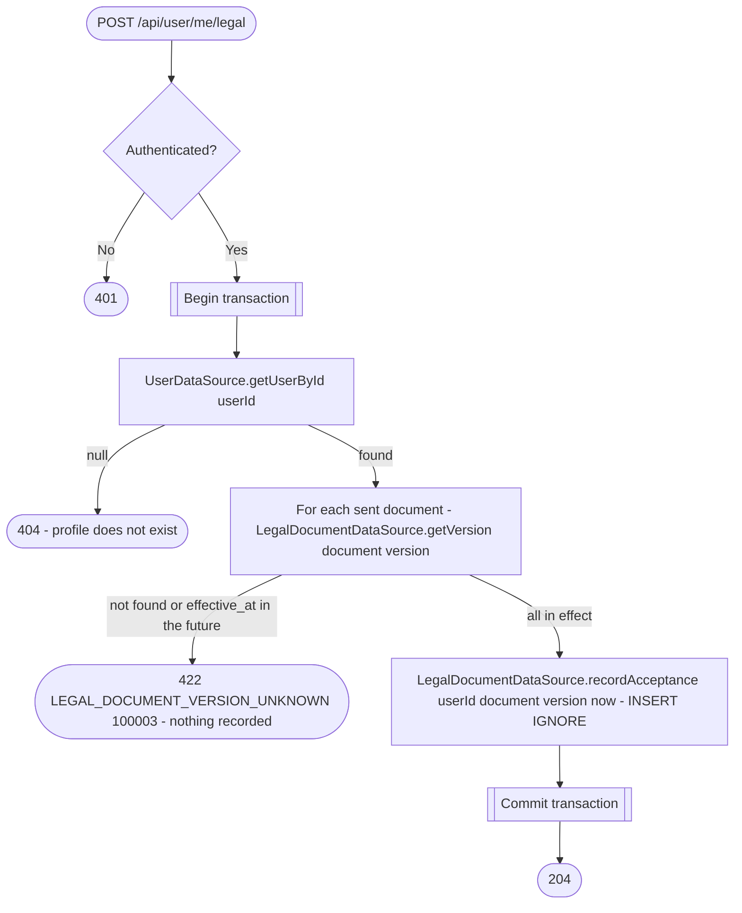

# Accept legal documents

`POST /api/user/me/legal` → `AcceptLegalDocuments`

Records that the caller accepted a version of the privacy policy and/or
the terms of service. The body (`AcceptedLegalDocuments`) has one
nullable version per document; a missing document is left as it is. Only
a version that is published (a `legal_document_version` row, see
[Legal documents](../../legal-documents.md)) and already in effect can be
accepted. Accepting the same version again changes nothing and keeps the
first acceptance time. All sent versions are checked before any is
recorded, so one unknown version records nothing.

The app finds out what to show from the two read routes, which don't
mutate and have no diagram: `GET /api/user/legal` (public, the version in
effect of each document, with its link) and `GET /api/user/me/legal` (the
same versions with the caller's `acceptedAt`, null when the caller still
has to accept it). The server never blocks a caller who hasn't accepted;
the app enforces it. Sign-up records the same acceptances through
[Create user (internal)](create-user-internal.md).

