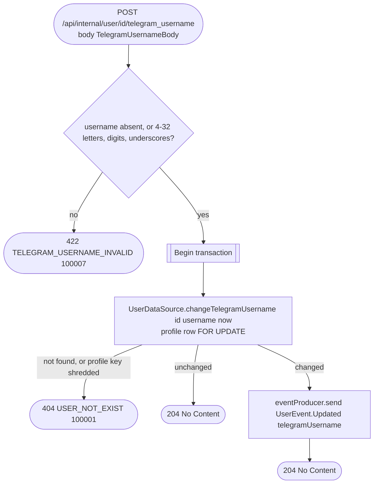

# Store the Telegram username (internal)

`POST /api/internal/user/{id}/telegram_username` → `ChangeTelegramUsername`

Called by auth after every Telegram sign-in of an existing account
([Sign in with Telegram](../authorization/telegram-sign-in.md)) with the
username read from the signed Mini App data, or with none when the user has
no username in Telegram. Users can't set it through `PATCH /api/user/me`.
The profile is written, its cache evicted and the change announced only when
the username differs from the stored one, so a sign-in with an unchanged
username writes nothing.

**Consumed by:** `UserEvent.Updated` → [business: sync denormalized client/
employee copies](../business/on-user-updated.md), which copies the username
onto the user's clients, and [notifications: sync the delivery
targets](../notifications/on-user-updated.md).
