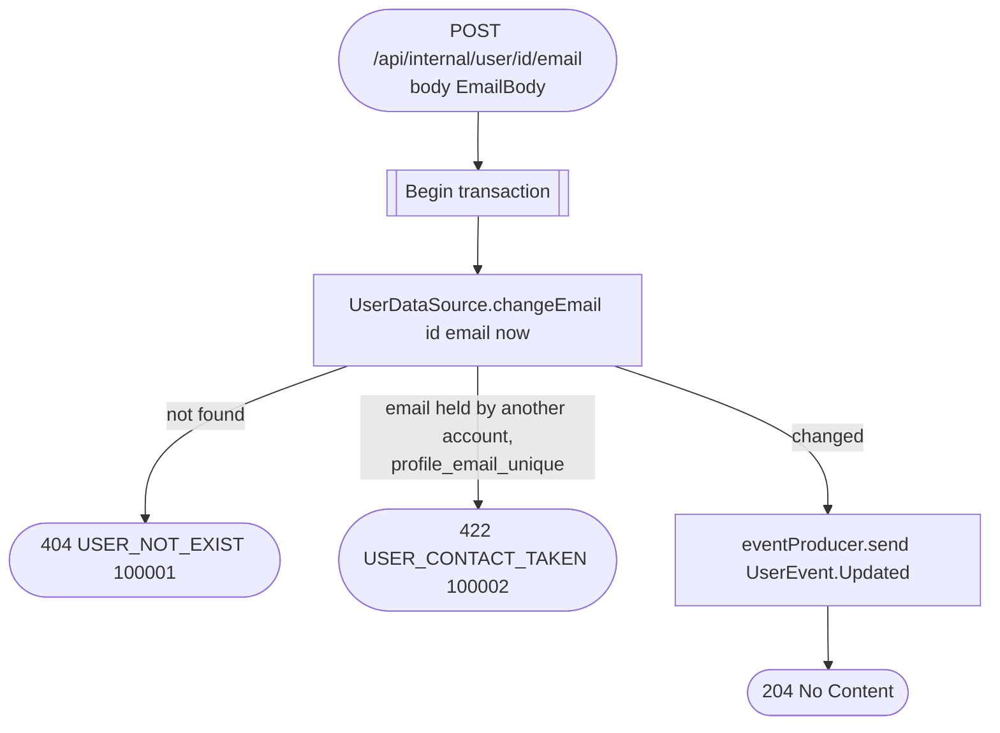

# Store a verified email (internal)

`POST /api/internal/user/{id}/email` → `ChangeUserEmail`

Called by auth once the user confirmed the code sent to their new address
([Confirm an email change](../authorization/confirm-email-change.md)). It is
the only write of `profile.email` after sign-up, and sign-up itself only
accepts a verified address, so every stored email has been verified. The
cached profile is evicted.

**Consumed by:** `UserEvent.Updated` → [business: sync denormalized client/
employee copies](../business/on-user-updated.md) and [notifications: sync
the email delivery target](../notifications/on-user-updated.md).
