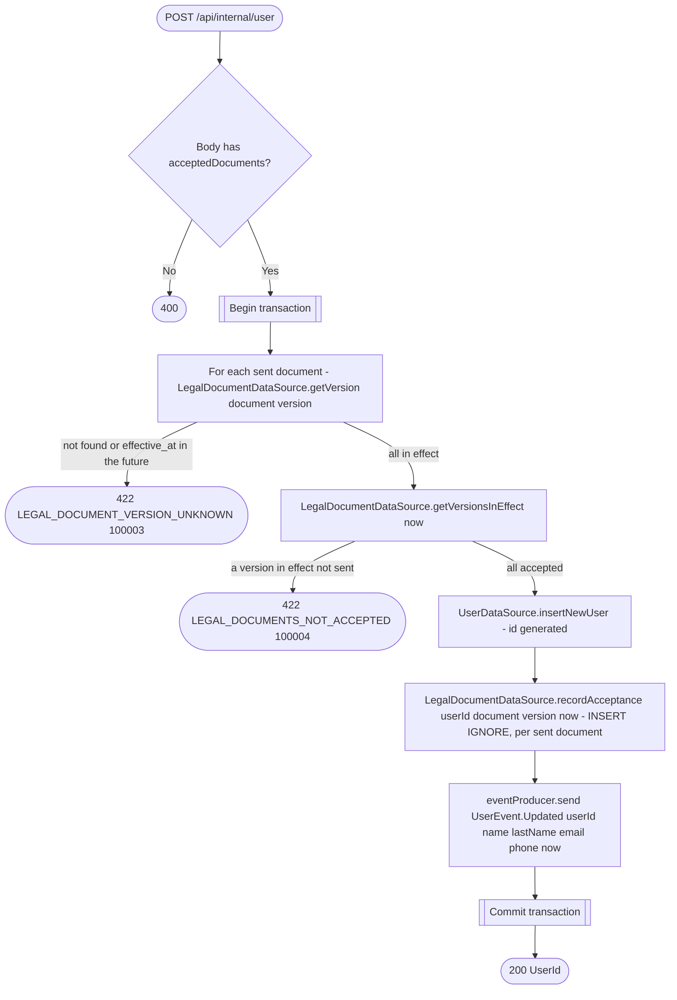

# Create user (internal)

`POST /api/internal/user` → `CreateUser`

Service-to-service route (no `authenticate {}`/`Security: jwt` — reachable
only from inside the deployment, e.g. from the authorization service
during [Sign-up](../authorization/sign-up.md)). The body is a `NewUser`:
the profile fields plus the legal document versions the user accepted in
the app (`acceptedDocuments`, required). A body without it, such as the
`User` an older auth service sends, is rejected with 400 before the
operation runs. Every sent version must be published and in effect, and
every document with a version in effect must be accepted in exactly that
version (see [Legal documents](../../legal-documents.md)); a document with
no published version needs nothing. Both checks run before the profile is
inserted, and the profile, its acceptances and a `UserEvent.Updated`
carrying the new profile are written in one transaction, so other
services learn the verified sign-up email without waiting for a profile
edit.

**Consumed by:** `UserEvent.Updated` → [business: sync denormalized client/
employee copies](../business/on-user-updated.md) and [notifications: sync
the email delivery target](../notifications/on-user-updated.md).
