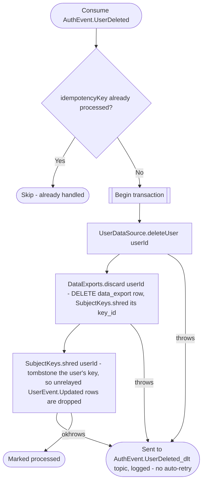

# React to user deletion

Kafka topic `AuthEvent.UserDeleted` → `UserEventHandler` → `DeleteUser`

Produced by [Delete account](../authorization/delete-account.md), the [`auth-handleDormantAccounts` job](../scheduled-jobs.md) and, after a backup restore, the [`auth-reapplyErasures` job](../scheduled-jobs.md). The user
service owns the profile row itself, so this is a hard delete, and the
user's legal document acceptances go with it
(`ON DELETE CASCADE`). The user's [data export](../../data-export.md) row
is deleted in the same transaction (`DataExports.discard`), so a document
being built for them is dropped and never announced — the other
consumers ([business](../business/on-user-deleted.md),
[appointments](../appointments/on-user-deleted.md),
[notifications](../notifications/on-user-deleted.md)) anonymize or clean up
their own denormalized copies independently and in no guaranteed order
relative to this one.

