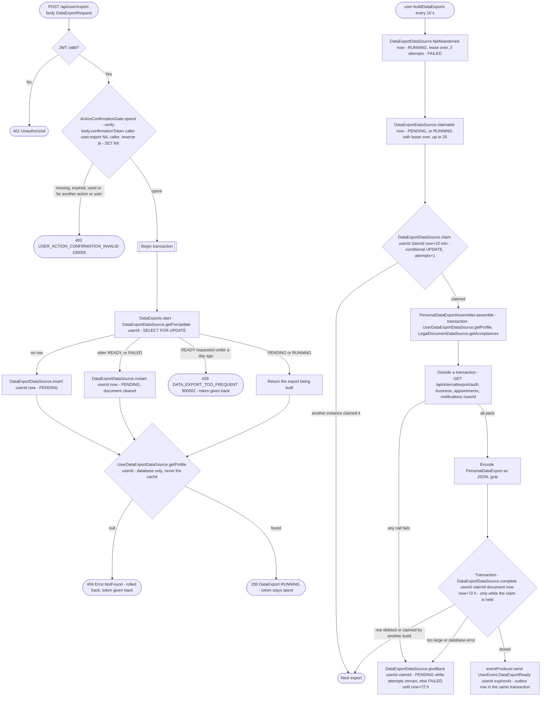

# Start personal data export

`POST /api/user/export` → `StartPersonalDataExport`, then the
`user-buildDataExports` job → `BuildDataExports` with
`PersonalDataExportAssembler`

Queues a JSON copy of everything Bookk holds about the caller, built in the
background and kept 72 hours. Lifecycle, storage and the document's
sections: [Data export](../../data-export.md).

The export must be confirmed with a passkey: the body carries an action confirmation
token from [Confirm a sensitive action with a
passkey](../authorization/action-confirmation.md), issued for this caller, the action
`user.export` (`EXPORT_PERSONAL_DATA`), the nil business id and the caller's
own user id as target. `ActionConfirmationGate.spend` checks it and spends its `jti`
once before the transaction; any failure after that gives the token back,
so a refused start (429) doesn't burn it. An app that sends no body gets
the same 403.

The two read routes don't mutate and have no diagram: `GET /api/user/export`
(the caller's `DataExport`: status, request time, expiry, when the next one
can start) and `GET /api/user/export/download` (the JSON file, 404 while
none is ready).

**Consumed by:** `UserEvent.DataExportReady` → [notifications: tell the user](../notifications/on-data-export-ready.md).
