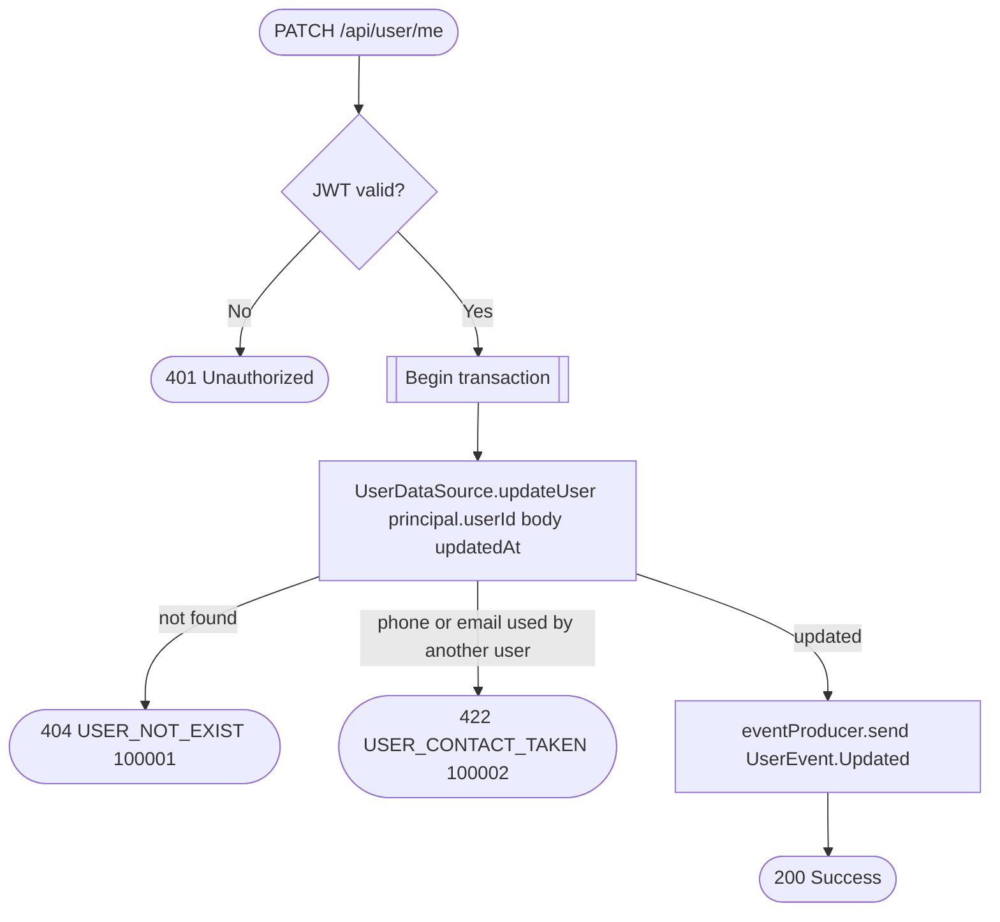

# Update user

`PATCH /api/user/me` → `EditUser`

Partial update of the caller's own profile; publishes `UserEvent.Updated`
so other services (business employee records, appointments client
snapshots) can react. Email and phone are unique across users
(`profile_email_unique`, `profile_phone_unique`); a blank phone clears it
and is stored as `NULL`, so profiles without a phone never collide.

**Consumed by:** `UserEvent.Updated` → [business: sync denormalized client/
employee copies](../business/on-user-updated.md) and [notifications: sync
the email delivery target](../notifications/on-user-updated.md).
