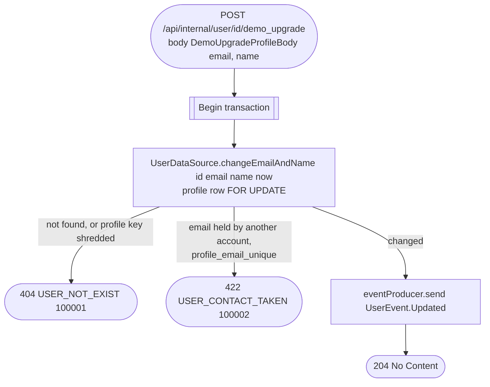

# Replace a demo profile (internal)

`POST /api/internal/user/{id}/demo_upgrade` → `UpgradeDemoProfile`

Called by auth when a demo account becomes a regular one
([Upgrade a demo account](../authorization/demo-upgrade.md)), after the user
confirmed the code sent to their address. It replaces the demo's placeholder
email and placeholder first and last name with the verified address and the
name the user gave, in one write and one `UserEvent.Updated`, so the profile
never has the real email with the placeholder name or the other way round.
It does not check that the profile is still a demo's: auth owns that state,
and a retry after a failed upgrade must be able to store a different address
over the one the earlier attempt stored. The cached profile is evicted.

**Consumed by:** `UserEvent.Updated` → [business: sync denormalized client/
employee copies](../business/on-user-updated.md) and [notifications: sync
the email delivery target](../notifications/on-user-updated.md).
